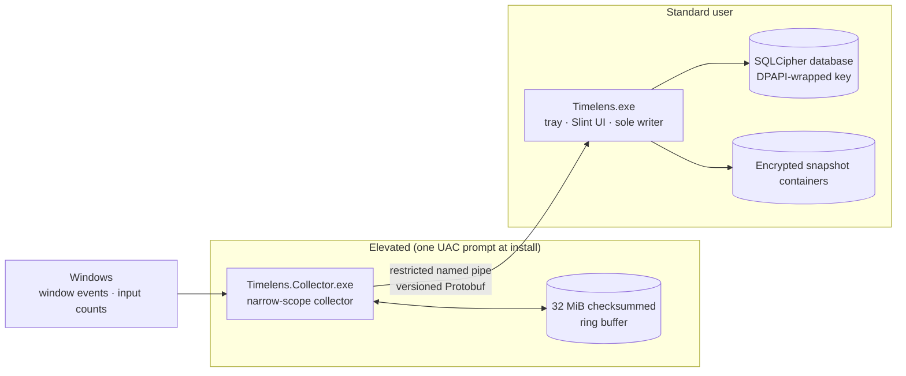

<p align="center">
  
</p>

<h1 align="center">Timelens</h1>

<p align="center">
  <b>Look back at your time, locally</b><br>
  Quietly records where your time goes on Windows. Everything stays on this PC, encrypted, and never touches the network.
</p>

<p align="center">
  <b>English</b> · <a href="README.zh-CN.md">简体中文</a>
</p>

<p align="center">
  <a href="https://github.com/ReasonW6/Timelens/actions/workflows/ci.yml"></a>
  
  
  
  
  
</p>

<p align="center">
  
</p>

> [!NOTE]
> Timelens is still in development and has not been released. The installer is not code-signed, so Windows SmartScreen may block it, and the [release matrix](docs/wayfinder/timelens-v1/performance-validation/milestone-5-physical-matrix.md) for real-hardware scenarios such as lock screen, sleep, multiple monitors and Remote Desktop is not finished yet.
>
> The user interface and most project documentation are currently in Simplified Chinese only. Menu names below are given in English with the original Chinese label in parentheses.

## Contents

- [What it does](#what-it-does)
- [Privacy promise](#privacy-promise)
- [How it works](#how-it-works)
- [Lightweight is a hard requirement](#lightweight-is-a-hard-requirement)
- [Installation and usage](#installation-and-usage)
- [Building from source](#building-from-source)
- [Project layout](#project-layout)
- [Documentation](#documentation)
- [Changelog](#changelog)

## What it does

### 🕒 Timeline: how your day went

The home page is a timeline that scrolls continuously day by day. Each row belongs to the application that held focus the longest during that stretch; applications you switched to only briefly are folded into the same row as "interleaved" apps, so the day is not chopped into fragments. Select an activity to see, on the right, its focused, background and on-screen durations, the other applications visible at the same time, and the keyboard and mouse counts for that period.

Time that was not recorded — because the collector was not running, or because too many records were dropped — is listed explicitly as "Not recorded 12 min · reason" instead of being silently filled in.

### 📊 Statistics: any period at a glance

<p align="center">
  
</p>

- Pick today, the last few hours, any date or time range, or "All records".
- Total focus time, number of applications, keystrokes and mouse clicks; for each application its share of focus, open time, on-screen time and window count.
- **Data coverage** shows how much of the period was actually observed. Expand it to see every gap and its reason, e.g. the collector was not running, you paused recording, or data was purged after the retention period.
- One-click **JSON / CSV export**. Exports contain only aggregate numbers, never application paths.

### ⌨️ Keys & system: how your input is distributed

<p align="center">
  
</p>

A physical keyboard heatmap shows how many times each key was pressed, left, middle and right mouse buttons are counted separately, and there are durations for system states such as lock screen and sleep, plus lifetime totals since you started using Timelens. Only press counts are kept — **what you type is never recorded**.

### 📷 Snapshots: optional visual look-back

By default Timelens captures the active display every 5 minutes, compresses it to WebP and stores it encrypted in per-day containers, kept for 7 days and capped at 1 GiB. You can turn snapshots off or mark specific applications as "Don't take snapshots". Lock screen, the secure desktop, remote sessions and similar cases are skipped, and the reason for each skip is recorded.

### 🛡️ Rules you control

<p align="center">
  
</p>

- Pause recording at any time.
- Per application, choose "Don't record activity", "Don't record input" or "Don't take snapshots".
- Merge the same program into one entry when its path or version changes.
- Delete the entire history of an application.
- Set a retention period and a storage cap; once the cap is reached, the oldest data is purged first.
- Clear all data with one click, which also rotates the encryption key.

## Privacy promise

| Timelens records | Timelens never records |
| --- | --- |
| Which application each switchable top-level window belongs to, and how long it was on screen, focused or in the background | Window titles, URLs, document or web page contents |
| Per-minute, per-application keyboard and mouse button counts | The text you type or the raw sequence of keys |
| Daily press counts for each physical key | Clipboard contents |
| Scheduled snapshots, if enabled (stored encrypted) | Helper processes, services or tray-only programs that are not on the taskbar |

- **Everything stays local**: the database is encrypted with SQLCipher, and its key is bound to the current Windows user via DPAPI. Timelens makes no network requests at all.
- **Missing means missing**: time that was not observed, purged, paused or excluded is always marked as such — never guessed or filled in.
- **Your data is portable**: portable ZIP backups can be password-protected. When uninstalling you can choose to keep or delete your data.

## How it works



- The **collector** runs as a highest-privilege logon task so it can observe elevated windows. It only observes and forwards; it does not link any database, UI or networking code. When the main app is temporarily unavailable, data goes into a checksummed ring buffer; if the buffer fills up, the newest data is kept and an explicit monitoring gap is recorded.
- The **main app** runs with standard privileges and owns the tray, the UI and all storage. It is the only writer to the database, and expensive queries run on background threads.
- During the **handshake** both sides verify they belong to the same user and the same session, that the PID is the real value reported by Windows, and that the executable name and directory match. Elevated components are installed under `C:\Program Files\Timelens`, which only SYSTEM and Administrators can write to. Because the binaries are not code-signed, these two checks are the security boundary that prevents someone from replacing the elevated component with a look-alike.

For the full reasoning, see the [architecture decision records](docs/adr) and the [V1 decision map](docs/wayfinder/timelens-v1/map.md).

## Lightweight is a hard requirement

| Metric | Target | Latest measurement (2026-09-05) |
| --- | --- | --- |
| Average CPU during normal collection | ≤ 1% | max 0.0792% |
| Resident process group memory | ≤ 100 MiB | peak working set 54.15 MiB |
| Installer size | ≤ 20 MiB | 9.665 MiB |
| 30 days of non-snapshot data | ≤ 100 MiB | 78.17 MiB |

> These measurements were taken before AI was removed, and the 30-day dataset still included 90 AI summaries. They have not been re-measured since AI and local reports were removed. See the [Milestone 4 & 5 report](docs/wayfinder/timelens-v1/performance-validation/milestone-4-5-report.md) for methodology and full data.

## Installation and usage

There is no released installer yet, so you need to [build from source](#building-from-source). Installation works like this:

1. Run `Timelens-<version>-x64-setup.exe` and confirm the UAC prompt once. The installer registers two logon tasks: the main app runs with standard privileges and the collector runs with highest privileges.
2. On first install, choose where to store data. By default it follows the install directory, in a `TimelensData` folder inside it; you can also choose `%LOCALAPPDATA%\Timelens` or any empty folder on a local fixed disk. A desktop shortcut is added by default and can be unchecked.
3. After installation Timelens stays in the system tray. Start at sign-in can be toggled under Settings › General (设置 › 常规).
4. To upgrade, just run the new installer; the data location and startup setting are preserved. To move existing data into the install directory, use Settings › Data (设置 › 数据) to relocate it to `TimelensData` under the install directory (an empty folder is prepared during upgrade).
5. Uninstall via the "Uninstall Timelens" shortcut in the install directory or from Windows "Installed apps". You can choose to keep or delete local data; files you exported are never deleted.

## Building from source

Prerequisites:

- [rustup](https://rustup.rs/). The repository pins Rust 1.94.1 in `rust-toolchain.toml`, which is installed automatically.
- A native Perl such as [Strawberry Perl](https://strawberryperl.com/), needed to build the OpenSSL bundled with SQLCipher. The Perl shipped with Git for Windows does not work.
- [Inno Setup 7](https://jrsoftware.org/isinfo.php), only needed to build the installer.

```powershell
$env:OPENSSL_SRC_PERL = 'C:\path\to\perl.exe'

# Same checks as CI
cargo fmt --all -- --check
cargo clippy --workspace --all-targets --all-features -- -D warnings
cargo test --workspace --release -- --test-threads=2

# Build and package the installer; output goes to dist\
cargo build --release -p timelens-app -p timelens-collector
& 'C:\path\to\ISCC.exe' 'installer\Timelens.iss'
```

<details>
<summary><b>Development cheat sheet</b></summary>

- The main app is single-instance. Before debugging locally, quit any installed Timelens and point the app at isolated data with `--data-dir <dir>`.
- Collector self-check: `cargo run -p timelens-collector -- --observe-windows-once` or `-- --observe-window-events-seconds 10`.
- Generate synthetic data: `cargo run -p timelens-storage --example design_fixture -- <empty dir>`.
- Headless screenshots: in a debug build, set `TIMELENS_QA_CAPTURE=<screenshot dir>` and `TIMELENS_QA_HEADLESS=1`. The app renders the main pages in memory one after another and saves screenshots, without opening a window or interfering with an installed Timelens. The images in this README were produced this way.
- Installer regression tests: `Invoke-Pester -Script .\installer\tests\startup.Tests.ps1` (Pester 3.4.0).
- `coordinated_clear_removes_offline_collector_artifacts` needs the collector's single-instance lock, so it fails while an installed collector is running.

</details>

## Project layout

| Directory | Responsibility |
| --- | --- |
| [`crates/timelens-app`](crates/timelens-app) | `Timelens.exe`: tray, Slint UI, sole database writer |
| [`crates/timelens-collector`](crates/timelens-collector) | `Timelens.Collector.exe`: narrow-scope elevated collector with a ring buffer |
| [`crates/timelens-observer`](crates/timelens-observer) | Window classification without reading titles, application identity resolution, virtual desktop queries and input counting |
| [`crates/timelens-ipc`](crates/timelens-ipc) | Versioned, length-limited Protobuf protocol and mutual named-pipe authentication |
| [`crates/timelens-storage`](crates/timelens-storage) | DPAPI + SQLCipher + WAL, recoverable migrations, encrypted snapshots, portable backups, corruption recovery |
| [`installer`](installer) | Inno Setup 7 script, logon task registration and maintenance scripts |

## Documentation

The documents below are written in Simplified Chinese.

- [Domain glossary](CONTEXT.md): precise meanings of terms such as Focus interval, Monitoring gap and Snapshot omission
- [V1 decision map](docs/wayfinder/timelens-v1/map.md) and [Wayfinder archive index](docs/wayfinder/README.md): the background of every product and architecture decision
- [Architecture decision records](docs/adr)
- [Data, retention and privacy contract](docs/wayfinder/timelens-v1/data-retention-privacy-contract.md)
- [UI acceptance](design-qa.md) and [design implementation notes](docs/design/rebuild-20260905/README.md)
- Validation reports: [Milestone 2](docs/wayfinder/timelens-v1/performance-validation/milestone-2-report.md) · [Milestone 3](docs/wayfinder/timelens-v1/performance-validation/milestone-3-report.md) · [Milestones 4 & 5](docs/wayfinder/timelens-v1/performance-validation/milestone-4-5-report.md) · [Physical release matrix](docs/wayfinder/timelens-v1/performance-validation/milestone-5-physical-matrix.md)

## Changelog

- **2026-10-21 · Local reports removed**: local reports duplicated the live statistics under Statistics › Apps, so reports are no longer stored. Data coverage and JSON / CSV export moved to the Apps tab and are computed live for the selected range; saved reports are deleted on upgrade. See [ticket 19](docs/wayfinder/timelens-v1/issues/19-remove-stored-usage-reports.md).
- **2026-10-21 · AI summaries removed**: AI could only see the same aggregate numbers as the statistics page, so the AI worker, provider credentials and AI settings were removed together, and Timelens no longer goes online; existing AI summaries and conversations are deleted on upgrade. See [ticket 18](docs/wayfinder/timelens-v1/issues/18-remove-ai-summaries.md).
- **2026-10-09 · Timeline redesign**: the home page now scrolls continuously by day, with brief switches folded into the same row as interleaved apps; app statistics show all records by default; scheduled snapshots skip cursor-only black frames returned by desktop duplication.
- **2026-09-06 · Paper-native UI**: the six main pages and the recovery window were rebuilt to the chosen design; see [UI acceptance](design-qa.md) for the review process.
- **2026-09-05 · Milestones 1–5**: window and input collection, timeline, snapshots, portable backup and restore, data relocation, and installation maintenance are all implemented.

Current protocol version is v4 and the database schema is v15.

## License

No open-source license has been chosen yet. Until a LICENSE file is added, all rights to the code in this repository are reserved.
