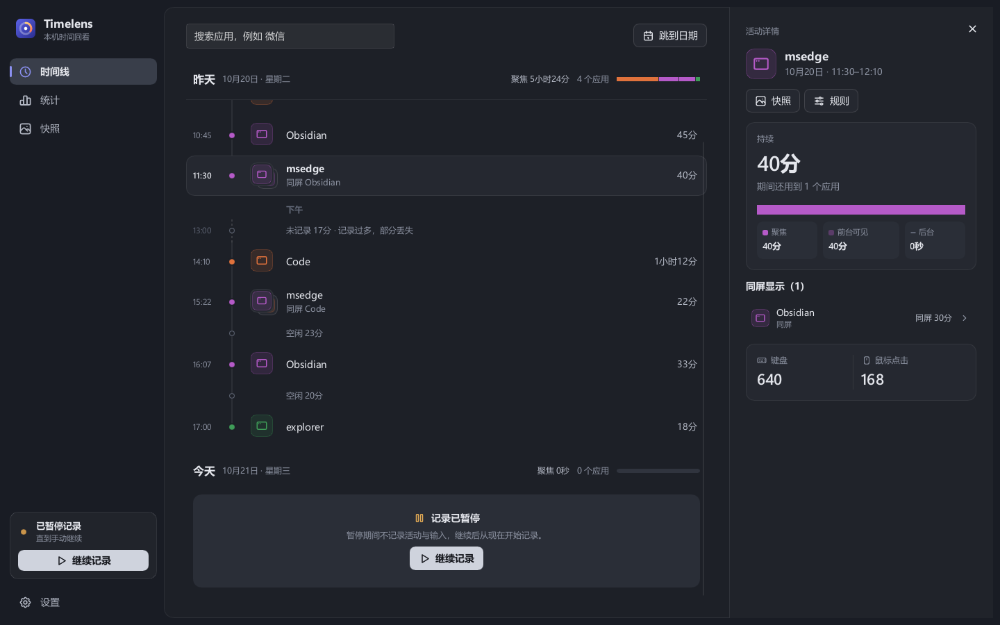
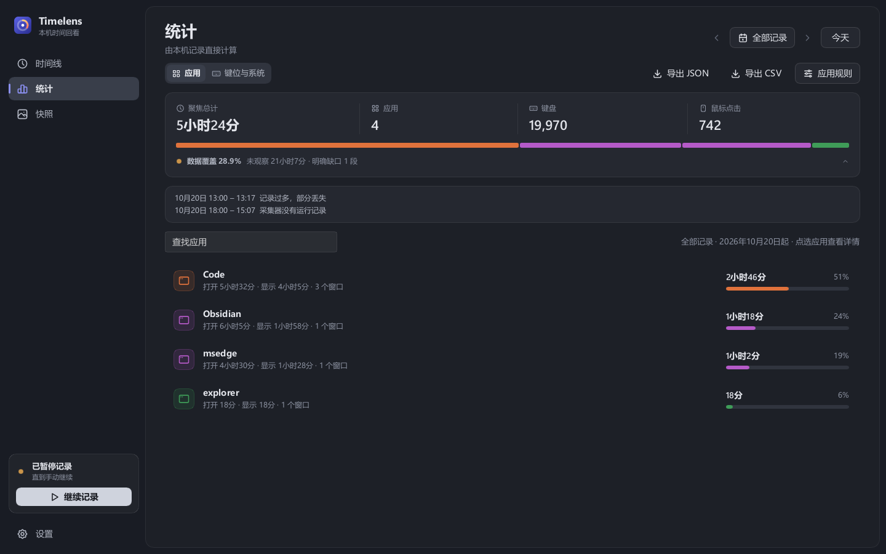
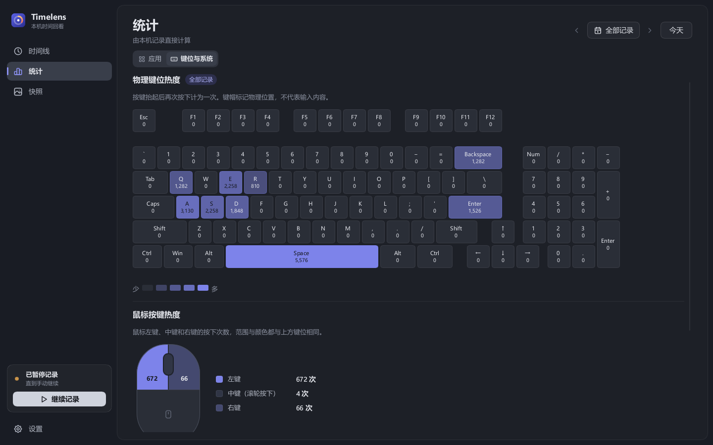
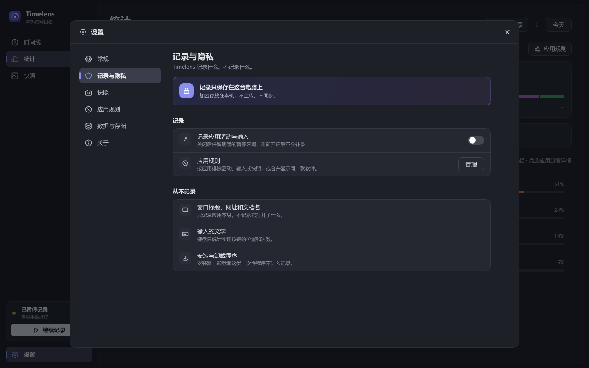
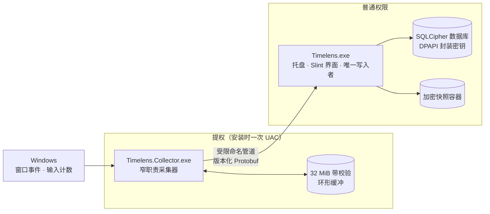

<p align="center">
  
</p>

<h1 align="center">Timelens</h1>

<p align="center">
  <b>本机时间回看</b><br>
  安静地记下你在 Windows 上把时间花在了哪里。所有数据都留在这台电脑上，加密保存，从不联网。
</p>

<p align="center">
  <a href="README.md">English</a> · <b>简体中文</b>
</p>

<p align="center">
  <a href="https://github.com/ReasonW6/Timelens/actions/workflows/ci.yml"></a>
  
  
  
  
  <a href="https://github.com/ReasonW6/Timelens/releases"></a>
</p>

<p align="center">
  
</p>

> [!NOTE]
> Timelens 目前是预览版：预发行安装包在 [Releases 页面](https://github.com/ReasonW6/Timelens/releases)，稳定的 1.0 还没有发布。安装包没有代码签名，Windows SmartScreen 可能会拦截；锁屏、睡眠、多屏、远程桌面等真机场景的[发布矩阵](docs/wayfinder/timelens-v1/performance-validation/milestone-5-physical-matrix.md)也还没跑完。

## 目录

- [它能做什么](#它能做什么)
- [隐私承诺](#隐私承诺)
- [工作原理](#工作原理)
- [轻量是硬性要求](#轻量是硬性要求)
- [安装与使用](#安装与使用)
- [从源码构建](#从源码构建)
- [项目结构](#项目结构)
- [文档](#文档)
- [更新记录](#更新记录)

## 它能做什么

### 🕒 时间线：一天是怎么过的

首页是按日连续滚动的时间线。每一行归到这段时间里聚焦最久的应用，中途短暂切过去的应用作为「穿插」并进同一行，不会把一天切成碎片。选中一段活动，右侧会显示这段的聚焦、后台和同屏显示时长、同时显示的其他应用，以及这段时间里的键盘和鼠标次数。

采集器没运行、记录过多被丢弃这类没记下来的时间，会以「未记录 12 分钟 · 原因」的形式明确列出来，不会悄悄补齐。

### 📊 统计：任意时段，一目了然

<p align="center">
  
</p>

- 选今天、最近几小时、任意日期或时段，也可以看「全部记录」。
- 聚焦总计、应用数、键盘和鼠标点击次数；每个应用的聚焦占比、打开时长、显示时长和窗口数。
- **数据覆盖**：显示这段时间里有多少被观察到了。点开可以看到每一段缺失和原因，例如采集器没在运行、你暂停了记录、超过保留期已清理。
- 一键 **导出 JSON / CSV**，导出内容只有聚合数字，不含应用路径。

### ⌨️ 键位与系统：输入的分布

<p align="center">
  
</p>

物理键位热度图展示每个键按了多少次，鼠标左、中、右键各自统计，另外还有锁屏、睡眠等系统状态的时长，以及自开始使用以来的累计总数。这里只有按键次数，**不记录你打了什么字**。

### 📷 快照：可选的画面回看

Timelens 默认每 5 分钟截取一次当前活动的显示器，压缩成 WebP 后加密存进按天划分的容器，默认保留 7 天、最多占用 1 GiB。可以关掉快照，也可以给某些应用设置「不拍摄快照」；锁屏、安全桌面、远程会话等情况会跳过，并记下跳过的原因。

### 🛡️ 你说了算的规则

<p align="center">
  
</p>

- 随时暂停记录。
- 可以按应用分别设置「不记录活动」「不记录输入」「不拍摄快照」。
- 同一个程序换了路径或版本，可以把它们合并显示。
- 可以删除某个应用的全部历史。
- 可以设置保留天数和空间上限，到了上限会从最旧的数据开始清理。
- 一键清空全部数据，同时轮换加密密钥。

## 隐私承诺

| Timelens 会记录 | Timelens 永远不会记录 |
| --- | --- |
| 你可以切换到的顶层窗口属于哪个应用，以及它显示、聚焦、在后台的时间 | 窗口标题、网址、文档或网页内容 |
| 每分钟按应用汇总的键盘次数和鼠标按键次数 | 你输入的文字、原始按键顺序 |
| 每个物理键的每日按下次数 | 剪贴板内容 |
| 你开启的定时快照（加密保存） | 不在任务栏的辅助进程、服务、纯托盘程序 |

- **全在本机**：数据库用 SQLCipher 加密，密钥由 Windows DPAPI 绑定到当前用户。Timelens 不发起任何网络请求。
- **缺什么就说缺什么**：没观察到、被清理、被暂停或被排除的时间都会明确标出，不推测，也不补齐。
- **数据可以带走**：便携 ZIP 备份可以设置密码。卸载时你可以选择保留或删除数据。
- **诊断日志也留在本机**：错误和崩溃信息写在 `%LOCALAPPDATA%\Timelens` 下的 `timelens.log` 和 `collector.log`，每个不超过 1 MiB。里面只有错误信息，没有窗口标题、输入内容或快照画面，也不会发送到任何地方；反馈问题时可以附上它们。

## 工作原理



- **采集器**以最高权限登录任务运行，这样才能观察提权窗口。它只负责观察和转发，不链接数据库、界面或网络代码。主程序暂时不可用时，数据先写进带校验的环形缓冲；缓冲满了会保留最新数据，并生成一段明确的记录缺口。
- **主程序**以普通权限运行，负责托盘、界面和全部存储。它是数据库唯一的写入者，耗时的查询放到后台线程。
- **握手**时会核对两端是同一用户、同一会话，PID 是 Windows 返回的真实值，可执行文件名和所在目录也都要对上。提权组件安装在 `C:\Program Files\Timelens`，目录只允许 SYSTEM 和管理员写入。因为没有代码签名，这两道检查就是防止有人用同名程序替换提权组件的安全边界。

更完整的推导过程见[架构决策记录](docs/adr)和 [V1 决策地图](docs/wayfinder/timelens-v1/map.md)。

## 轻量是硬性要求

| 指标 | 目标 | 最近一次实测（2026-09-05） |
| --- | --- | --- |
| 正常采集平均 CPU | ≤ 1% | 最大 0.0792% |
| 常驻进程组内存 | ≤ 100 MiB | 峰值工作集 54.15 MiB |
| 安装包 | ≤ 20 MiB | 9.665 MiB |
| 30 天非截图数据 | ≤ 100 MiB | 78.17 MiB |

> 上表实测在移除 AI 之前完成，30 天数据量里还包含 90 份 AI 总结。0.1.1（2026-10-22）的安装包为 10.89 MiB；用小型合成数据测量，核心单进程在窗口首次显示前占用私有内存 5.9 MiB，显示后为 16.9 MiB；其他几项在移除 AI 和本地报告之后还没有重新测量，详细方法和完整数据见[里程碑 4、5 报告](docs/wayfinder/timelens-v1/performance-validation/milestone-4-5-report.md)。

## 安装与使用

从 [Releases 页面](https://github.com/ReasonW6/Timelens/releases)下载 `Timelens-<版本>-x64-setup.exe`，或者[从源码构建](#从源码构建)。安装过程是这样的：

1. 运行 `Timelens-<版本>-x64-setup.exe`，确认一次 UAC。安装器跟随 Windows 的显示语言（简体中文、繁体中文、英文、日文或韩文，其他语言显示英文）。安装器会注册两个登录任务：主程序以普通权限运行，采集器以最高权限运行。
2. 首次安装时选择数据位置，默认跟随安装目录，放在其中的 `TimelensData` 文件夹；也可以选 `%LOCALAPPDATA%\Timelens`，或本地固定磁盘上任意一个空文件夹。安装器默认会添加桌面快捷方式，可以取消勾选。
3. 安装完成后，Timelens 会常驻在托盘里。在「设置 › 常规」里可以开关开机自启、切换界面语言。
4. 升级时直接运行新的安装包，数据位置和自启动设置都会保留。想把已有数据搬进安装目录，可以在「设置 › 数据」里迁移到安装目录下的 `TimelensData`（升级时已准备好这个空文件夹）。
5. 卸载可以用安装目录里的「卸载 Timelens」快捷方式（名称随安装器语言变化）或系统的「已安装的应用」。卸载时可以选择保留或删除本地数据，你导出的文件不会被删除。

## 从源码构建

需要准备：

- [rustup](https://rustup.rs/)。仓库用 `rust-toolchain.toml` 固定了 Rust 1.94.1，会自动安装。
- 原生 Perl，例如 [Strawberry Perl](https://strawberryperl.com/)。SQLCipher 附带的 OpenSSL 编译时要用；Git for Windows 自带的 Perl 不行。
- [Inno Setup 7](https://jrsoftware.org/isinfo.php)，只在打安装包时需要。

```powershell
$env:OPENSSL_SRC_PERL = 'C:\path\to\perl.exe'

# 与 CI 一致的检查
cargo fmt --all -- --check
cargo clippy --workspace --all-targets --all-features -- -D warnings
cargo test --workspace --release -- --test-threads=2

# 构建并打安装包，产物在 dist\
# 安装包的版本号取自 release 构建，release 构建又取自 Cargo.toml
cargo build --release -p timelens-app -p timelens-collector
& 'C:\path\to\ISCC.exe' 'installer\Timelens.iss'
```

<details>
<summary><b>开发调试小抄</b></summary>

- 主程序是单实例的。本地调试前先退出已安装的 Timelens，再用 `--data-dir <目录>` 指向一份隔离的数据。
- 采集器自检：`cargo run -p timelens-collector -- --observe-windows-once`，或 `-- --observe-window-events-seconds 10`。
- 生成合成数据：`cargo run -p timelens-storage --example design_fixture -- <空目录>`。
- 无头截图：在调试构建里设置 `TIMELENS_QA_CAPTURE=<截图目录>` 和 `TIMELENS_QA_HEADLESS=1`，程序会在内存里依次渲染主要页面并保存截图，不弹窗口，也不影响已安装的 Timelens。本页的配图就是这样生成的。
- 安装器回归：`Invoke-Pester -Script .\installer\tests\startup.Tests.ps1`（Pester 3.4.0）。
- 发布：先改 `Cargo.toml` 里的 `version`，再推送 `v<版本>` 标签（例如 `v0.1.1`）。Release workflow 会核对标签与版本一致、构建安装包，并创建附带 SHA-256 的 GitHub 草稿发布；说明文字改好后手动发布。
- `coordinated_clear_removes_offline_collector_artifacts` 需要拿到采集器的单实例锁，已安装的采集器在运行时这项测试会失败。

</details>

## 项目结构

| 目录 | 职责 |
| --- | --- |
| [`crates/timelens-app`](crates/timelens-app) | `Timelens.exe`：托盘、Slint 界面、唯一的数据库写入者 |
| [`crates/timelens-collector`](crates/timelens-collector) | `Timelens.Collector.exe`：窄职责的提权采集器，带环形缓冲 |
| [`crates/timelens-observer`](crates/timelens-observer) | 不读窗口标题的窗口分类、应用身份解析、虚拟桌面查询和输入计数 |
| [`crates/timelens-ipc`](crates/timelens-ipc) | 版本化、限长的 Protobuf 协议和命名管道双向认证 |
| [`crates/timelens-storage`](crates/timelens-storage) | DPAPI + SQLCipher + WAL、可恢复的迁移、加密快照、便携备份、损坏恢复 |
| [`installer`](installer) | Inno Setup 7 脚本、登录任务注册与维护脚本 |

## 文档

- [领域术语](CONTEXT.md)：Focus interval、Monitoring gap、Snapshot omission 等词的准确含义
- [V1 决策地图](docs/wayfinder/timelens-v1/map.md)和 [Wayfinder 归档入口](docs/wayfinder/README.md)：每个产品和架构决定的来龙去脉
- [架构决策记录](docs/adr)
- [数据、清理与隐私合同](docs/wayfinder/timelens-v1/data-retention-privacy-contract.md)
- [界面验收](design-qa.md)和[设计实施记录](docs/design/rebuild-20260905/README.md)
- 验收报告：[里程碑 2](docs/wayfinder/timelens-v1/performance-validation/milestone-2-report.md) · [里程碑 3](docs/wayfinder/timelens-v1/performance-validation/milestone-3-report.md) · [里程碑 4、5](docs/wayfinder/timelens-v1/performance-validation/milestone-4-5-report.md) · [实机发布矩阵](docs/wayfinder/timelens-v1/performance-validation/milestone-5-physical-matrix.md)

## 更新记录

- **2026-10-22 · 界面缩放**：「设置 › 常规」新增「界面缩放」选项（80%–150%），在 Windows 显示缩放的基础上放大或缩小界面。切换后立即生效，在显示器之间移动时保持；屏幕放不下最小尺寸的窗口时，会自动减小放大比例。
- **2026-10-22 · 0.1.1**：安装器支持和应用相同的五种语言；程序文件带上版本信息；错误和崩溃写入本机诊断日志；安装包改由 Release workflow 构建，依赖会对照 RustSec 安全公告库检查。
- **2026-10-21 · 界面多语言**：「设置 › 常规」新增「语言」选项，可选系统默认、简体中文、繁体中文、English、日本語、한국어。系统默认跟随 Windows 的显示语言，其他语言显示为英文；切换后立即生效，托盘菜单也一并更新。
- **2026-10-21 · 移除本地报告**：本地报告和「统计 › 应用」的实时统计重复，所以不再保存报告。数据覆盖和 JSON / CSV 导出移到「应用」标签，按所选范围实时计算；升级时会删除已经保存的报告。见[票据 19](docs/wayfinder/timelens-v1/issues/19-remove-stored-usage-reports.md)。
- **2026-10-21 · 移除 AI 总结**：AI 只能看到和统计页相同的聚合数字，所以 AI worker、提供商凭据和 AI 设置一并移除，Timelens 从此不再联网；升级时会删除已有的 AI 总结和对话。见[票据 18](docs/wayfinder/timelens-v1/issues/18-remove-ai-summaries.md)。
- **2026-10-09 · 时间线改版**：首页改为按日连续滚动，短暂切换作为穿插应用并入同一行；应用统计默认显示全部记录；定时快照会跳过桌面复制返回的只有鼠标的黑帧。
- **2026-09-06 · Paper 原生界面**：六个主页面和恢复窗口按选定的设计重做，验收过程见[界面验收](design-qa.md)。
- **2026-09-05 · 里程碑 1–5**：窗口与输入采集、时间线、快照、便携备份恢复、数据迁移和安装维护全部实现。

当前协议版本为 v4，数据库 schema 为 v15。

## 许可证

还没有选定开源许可证。在添加 LICENSE 文件之前，本仓库的代码保留所有权利。
